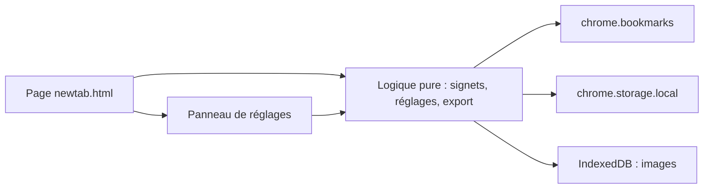

# Speed Dial Vivaldi — Architecture technique

> Version 1 · 2026-10-17

## 1. Résumé

| Couche | Choix | Pourquoi | Alternative écartée |
|---|---|---|---|
| Interface | HTML + CSS + JavaScript (modules ES), sans framework | Page unique, peu d'états ; aucun outil de build à maintenir | React/Vue : surcoût sans exigence du MVP |
| Logique | Modules purs (arbre de signets, réglages, validation, export) séparés des API `chrome.*` | Testables sans navigateur | Logique dans l'interface : intestable |
| Stockage | `chrome.storage.local` (réglages) + IndexedDB (images : vignettes et fond) | Réglages petits ; images volumineuses hors de la limite de 10 Mo de `storage.local` | `storage.sync` : limite d'environ 100 Ko, réservé à F9 |
| Serveur / services | Aucun | Aucun besoin : H3, pas de partage | Serveur : sans objet |
| Tests | `node --test` (lanceur intégré à Node) + scénarios manuels dans Vivaldi | Zéro dépendance | Jest/Vitest : dépendance inutile |
| Distribution | Extension non empaquetée chargée dans Vivaldi | Usage personnel (H3) | Chrome Web Store : seulement si publication souhaitée |

## 2. Contexte existant

Nouveau projet dans cette conversation : aucun code transmis. Si la page Speed Dial de Link Peek contient déjà du code utile (Q1), il serait réutilisé pour la grille et le stockage, sans réécriture inutile. **Conventions retenues** : commentaires, messages de journal et noms de variables en français.

**Faits de plateforme** (référence Chrome du skill, consultée en octobre 2026, non revérifiée dans cette session) : Manifest V3 obligatoire ; `chrome.storage.local` limité à 10 Mo par défaut et effacé à la désinstallation ; `chrome.storage.sync` limité à environ 100 Ko. **[À vérifier]** : disponibilité exacte de `chrome.bookmarks` et de l'API `favicon` dans la version de Vivaldi de l'utilisateur (H4).

## 3. Composants



- **Page `newtab.html`** : grille, groupes, sélecteur, panneau de réglages.
- **`signets.js`** : lecture de l'arbre, filtres, opérations (ajout, modification, suppression, déplacement), tout via une interface injectable.
- **`reglages.js`** : valeurs par défaut, validation, migration de version.
- **`images.js`** : lecture et écriture des images dans IndexedDB, contrôle de taille.
- **`export.js`** : export et import JSON versionnés.

## 4. Local ou serveur

| Fonction | Où elle s'exécute | Service externe | Clé secrète | Repli si indisponible |
|---|---|---|---|---|
| Lecture et écriture des signets | Local (Vivaldi) | Aucun | Non | Bandeau d'erreur + Réessayer |
| Réglages | Local | Aucun | Non | Valeurs par défaut |
| Icônes des sites | Local (API `favicon` du navigateur) **[À vérifier]** | Aucun | Non | Initiale colorée |
| Images (vignettes, fond) | Local (IndexedDB) | Aucun | Non | Tuile sans image, fond uni |
| Export / import | Local | Aucun | Non | Message d'erreur, réglages inchangés |

Contrainte exprimée : aucune dépendance payante ni serveur. Vérifié ligne par ligne : respecté.

## 5. Modèle de données

**`reglages`** (`chrome.storage.local`, clé `reglages`, `version: 1`) :

| Champ | Type | Contrainte |
|---|---|---|
| `version` | entier | 1 |
| `groupes` | liste de `{ idDossier, cheminDossier, libelle }` | 1 à 20 ; `cheminDossier` = suite des titres, pour retrouver le dossier à l'import |
| `groupeActif` | texte | un `idDossier` ou vide |
| `colonnesMax` | entier | 2 à 10 |
| `tailleTuile` | texte | `petite`, `moyenne`, `grande` |
| `theme` | texte | `clair`, `sombre`, `auto` |
| `fond` | `{ type, valeur, voile }` | type `couleur`, `degrade` ou `image` ; voile de 0 à 80 % |

**IndexedDB `speeddial`** : magasin `images`, clé `vignette:<adresse du signet>` ou `fond`, valeur = `Blob` ; 2 Mo maximum par vignette, 5 Mo pour le fond. Volume prévu : quelques dizaines d'images. Conservation : jusqu'à suppression ; effacées à la désinstallation, d'où F5.

Source de vérité des tuiles : l'arbre des signets de Vivaldi (aucune copie).

## 6. Interfaces et intégrations

- `chrome.bookmarks` : `getTree`, `getChildren`, `create`, `update`, `remove`, `move` **[À vérifier dans Vivaldi, H4]**.
- Export : `Blob` + lien de téléchargement depuis la page, sans permission `downloads`.
- Aucune API externe.

## 7. Authentification et permissions

Sans objet : pas de compte. Permissions : `bookmarks`, `storage`, éventuellement `favicon` ; aucune permission d'hôte (justifications dans FEATURES_AND_ACCEPTANCE.md, section 5).

## 8. Sécurité, validation et erreurs

- **Entrées** : titres et adresses validés (longueur, schéma `http`/`https`) ; fichiers d'import validés par structure et version avant toute écriture ; images contrôlées en type et taille.
- **Sorties** : titres insérés comme texte (`textContent`), jamais en HTML ; pas de `eval`, aucun code distant, aucune ressource externe.
- **Politique de contenu** : celle par défaut de Manifest V3, sans assouplissement.
- **Erreurs** : message clair à l'utilisateur, détail en français dans la console ; les opérations sur signets échouent sans état partiel (une seule opération API par action).
- **Secrets** : aucun, donc pas de `.env`.

## 9. Dépendances

| Dépendance | Rôle | Licence | Coût | Alternative |
|---|---|---|---|---|
| Aucune dépendance d'exécution | — | — | 0 | — |
| Node.js (développement seulement) | Lanceur de tests `node --test` | Voir la distribution Node | 0 | Navigateur seul |
| `jsdom` 30.1.1 (développement seulement) | Page simulée pour `npm run test:interface` | MIT | 0 | Tests manuels seuls |
| `fake-indexeddb` 6.2.5 (développement seulement) | IndexedDB simulée pour `npm run test:interface` | Apache-2.0 | 0 | Tests manuels seuls |

## 10. Tests

- **Unitaires et intégration** : modules purs testés avec `node --test`, API `chrome.*` simulées. Commande : `npm test` (soit `node --test "tests/*.test.js"`), aucune dépendance à installer.
- **Interface simulée** : `tests-interface/` fait tourner la vraie page (`newtab.html` et `src/interface.js`) dans jsdom, avec une API de signets et une IndexedDB simulées. Commande : `npm install` puis `npm run test:interface`. Versions des deux outils épinglées, d'au moins 14 jours d'ancienneté au moment du choix.
- **Manuel** : tests dans Vivaldi (chargement non empaqueté) pour tout ce qui touche aux vrais signets, au démarrage, au rendu et au téléchargement. Ni les tests unitaires ni jsdom ne prouvent le comportement de Vivaldi.

## 11. Build, déploiement et maintenance

Aucun build. Installation : charger le dossier via la page des extensions de Vivaldi en mode développeur. Pour l'utiliser au démarrage, renseigner l'adresse de la page de l'extension comme page de démarrage (H6). Maintenance : relire les notes de version de Vivaldi lors des mises à jour majeures.

## 12. Coûts récurrents

| Poste | Coût | Source |
|---|---|---|
| Hébergement, domaine, API | 0 | Aucun service utilisé |
| Publication sur un store | Non prévue | **[À vérifier]** si elle devient souhaitée |

## 13. Décisions d'architecture

- **ADR-1 — Tuiles = signets, sans copie** : une seule source de vérité, cohérente avec le fonctionnement natif du Speed Dial (aide Vivaldi). Conséquence : modifier une tuile modifie le signet.
- **ADR-2 — Dossiers choisis par l'utilisateur** : les dossiers « Speed Dial » natifs ne sont pas supposés détectables (H7). Conséquence : sélecteur en arbre (F2).
- **ADR-3 — Images dans IndexedDB** : évite la limite de `storage.local`. Conséquence : export des images encodées dans le JSON (F5).
- **ADR-5 — Vignettes rangées par adresse, pas par identifiant** (décision prise en T6) : un signet supprimé puis restauré reçoit un nouvel identifiant mais garde son adresse, et l'export de T7 a besoin d'un lien stable. Conséquences : deux signets de même adresse partagent leur vignette ; modifier l'adresse déplace la vignette ; supprimer un signet laisse sa vignette en réserve (elle réapparaît à la restauration), au prix de quelques images orphelines.
- **ADR-4 — Aucune vignette de capture d'écran** : H5. Conséquence : icône du site, image locale ou initiale.

## 14. Arborescence proposée

```
speed-dial-vivaldi/
  manifest.json
  newtab.html
  src/
    signets.js
    reglages.js
    images.js
    export.js
    sauvegarde.js
    interface.js
  styles/
    page.css
  tests/
    signets.test.js
    reglages.test.js
    images.test.js
    export.test.js
  tests-interface/
    aide.js
    parcours.test.js
  README.md
  product/
```
